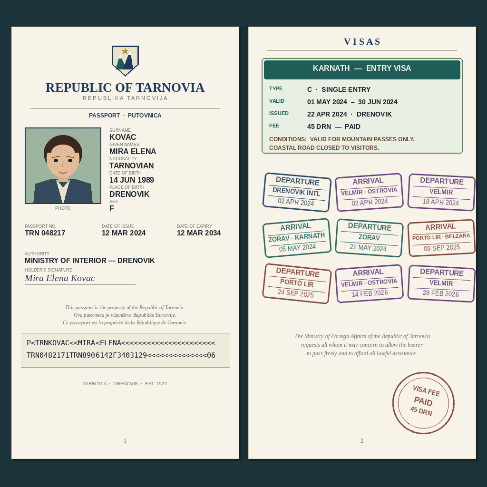

# The Passport Page of a Country That Isn't There

[](https://make.fun/bounty/the-passport-page-of-a-countr-2-20261121-0318)
[](https://make.fun/bounty/the-passport-page-of-a-countr-2-20261121-0318/leaderboard)
[](https://make.fun/bounty/the-passport-page-of-a-countr-2-20261121-0318)

An entry for the [make.fun bounty](https://make.fun/bounty/the-passport-page-of-a-countr-2-20261121-0318): a program that draws an open passport spread for a country that does not exist.



## The invented country

**The Republic of Tarnovia** — a landlocked mountain republic, capital
**Drenovik**, currency the drenar (DRN). Its neighbours are Ostrovia
(capital Velmir), Karnath (capital Zorav) and Belzara (port city Porto Lir).

The holder is **Mira Elena Kovac**, born 14 June 1989 in Drenovik.
Passport TRN 048217, issued 12 March 2024 in Drenovik, valid to 12 March
2034.

## The travel history (every stamp agrees with the passport)

- 02 Apr 2024 — departs Drenovik, arrives Velmir (Ostrovia) the same day
- 18 Apr 2024 — departs Velmir
- 22 Apr 2024 — Karnath entry visa issued in Drenovik (valid 01 May – 30 Jun 2024)
- 05 May 2024 — arrives Zorav (Karnath); departs 21 May 2024
- 09 Sep 2025 — arrives Porto Lir (Belzara); departs 24 Sep 2025
- 14 Feb 2026 — arrives Velmir again; departs 28 Feb 2026

The telling detail: the Karnath visa is **valid for mountain passes only —
the coastal road is closed to visitors** — and the visa fee of 45 drenars
is stamped paid.

## How it runs

```sh
python3 main.py            # writes entry.png here
MAKEFUN_OUTPUT_DIR=/output python3 main.py
```

`main.py` (Python 3.13, stdlib + Pillow) renders the spread with
`render.py` and writes `entry.png` (1024×1024, deterministic — two runs
are byte-identical). Everything is drawn in code: the coat of arms, the
portrait, the stamps, and the machine-readable zone (ICAO 9303 check
digits computed in code).
